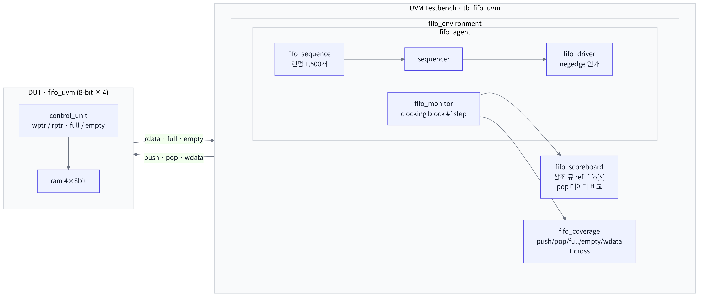
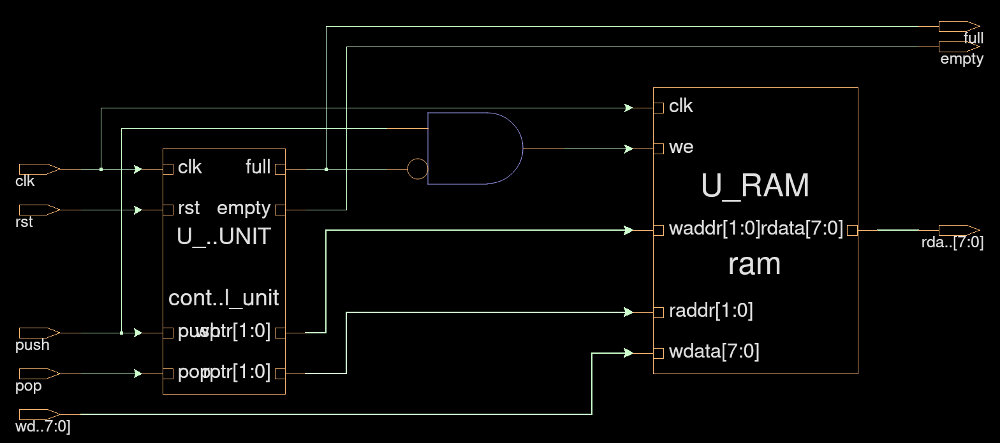
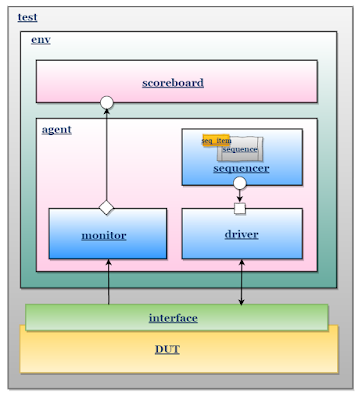
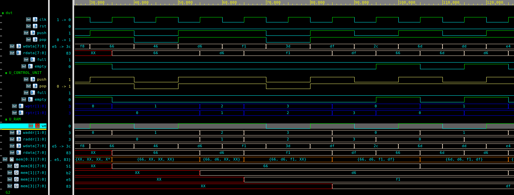
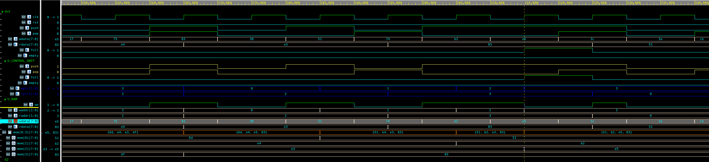
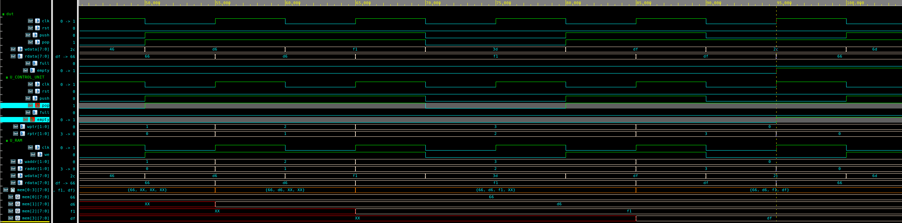
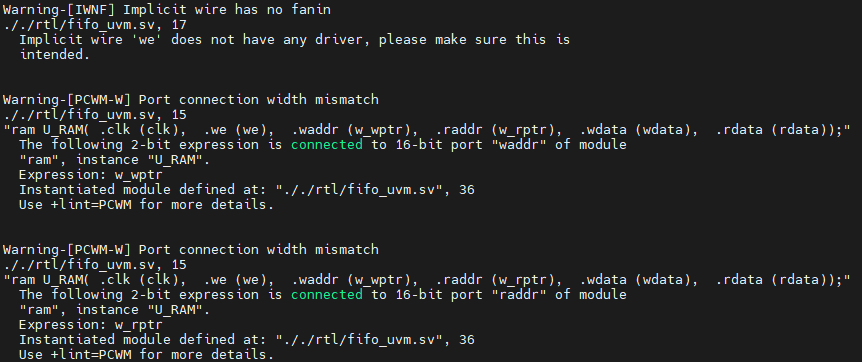

# FIFO UVM Verification

SystemVerilog로 설계한 **8-bit × 4-depth 동기 FIFO**를 **UVM 테스트벤치**로 검증한 프로젝트입니다.
랜덤 push/pop 시퀀스 1,500개를 인가하고, 스코어보드의 참조 모델과 비교해 **fail 0건, functional coverage 100%** 를 달성했습니다.

## System Overview



### System Flow

위 그림에서 트랜잭션 하나가 이렇게 흐르며 검증됩니다.

1. **Sequence → Sequencer → Driver (자극 생성)**
   `fifo_sequence`가 `push`, `pop`, `wdata`를 랜덤으로 만든 트랜잭션 1,500개를 생성하고, Driver가 클럭 negedge에 인터페이스를 통해 DUT에 인가합니다.
2. **DUT (FIFO 동작)**
   `control_unit`이 `{push, pop}` 조합에 따라 `wptr`/`rptr`와 `full`/`empty`를 갱신하고, `ram`에 쓰거나 `rdata`(조합 출력)로 읽습니다.
3. **Monitor (관측)**
   clocking block(`#1step`)으로 클럭 엣지 직전의 입출력 값을 샘플링해서, analysis port로 Scoreboard와 Coverage에 동시에 보냅니다.
4. **Scoreboard (정답 비교)**
   SystemVerilog 큐(`ref_fifo[$]`)로 만든 참조 모델에 push 데이터를 넣고, pop할 때 꺼낸 기대값과 DUT의 `rdata`를 비교해 PASS/FAIL을 셉니다.
5. **Coverage (검증 완성도)**
   push/pop/full/empty/wdata와 cross 조합이 모두 나왔는지 기록하고, 시뮬레이션 끝에 pass·fail 개수와 coverage를 리포트합니다.

## DUT: FIFO



| 포트 | 설명 |
|---|---|
| `push` / `wdata[7:0]` | 쓰기 요청 / 쓰기 데이터 |
| `pop` / `rdata[7:0]` | 읽기 요청 / 읽기 데이터 (조합 출력) |
| `full` / `empty` | 상태 플래그 |

- **RAM**: 4 × 8bit 레지스터 배열, `we = push && !full`일 때만 쓰기
- **Control Unit**: `{push, pop}` 조합에 따라 `wptr`/`rptr`와 `full`/`empty`를 갱신
  - 동시 push/pop 시 full이면 pop만, empty면 push만, 그 외에는 둘 다 수행

## UVM 테스트벤치 구조



| 컴포넌트 | 역할 |
|---|---|
| `fifo_seq_item` | `push`, `pop`, `wdata` 랜덤화 (push/pop 각각 1:1 분포) |
| `fifo_sequence` | 트랜잭션 1,500개 생성 |
| `fifo_driver` | negedge에 DUT로 신호 인가 |
| `fifo_monitor` | clocking block으로 DUT 입출력 샘플링 후 analysis port로 전달 |
| `fifo_scoreboard` | SystemVerilog 큐(`ref_fifo[$]`)로 참조 모델 구현, pop 데이터 비교 |
| `fifo_coverage` | push/pop/full/empty/wdata 커버포인트 + cross coverage |

## 결과

```
*** Overall      = 100.0% ***
*** push         = 100.0% ***      *** full         = 100.0% ***
*** pop          = 100.0% ***      *** empty        = 100.0% ***
*** wdata        = 100.0% ***      *** push/pop     = 100.00% ***
                                   *** full_empty   = 100.00% ***
********* pass count = 652 *********
********* fail count =  0 *********
```

| Normal | Full | Empty |
|---|---|---|
|  |  |  |

## 트러블슈팅

### 1. PASS/FAIL 카운트가 출력되지 않음
- **현상**: 시뮬레이션은 돌지만 스코어보드 결과가 나오지 않음
- **원인**: 컴파일 경고 확인 결과, `we`가 선언 전에 사용돼 **driver 없는 implicit wire**로 처리됐고, RAM의 주소 포트 폭(16bit)이 포인터(2bit)와 맞지 않았음
- **해결**: `we`를 인스턴스 이전에 선언하고, RAM 주소 포트를 `[1:0]`로 맞춤



### 2. 데이터가 맞는데 FAIL 발생
- **현상**: 기대값 255인데 모니터는 232를 읽어 FAIL 판정
- **원인**: 모니터가 `@(posedge clk)` 후 `#1` 지연으로 샘플링했는데, `rdata`는 `mem[rptr]` **조합 출력**이라 엣지에서 `rptr`가 갱신되자마자 다음 데이터로 바뀜. 결국 이번 클럭이 아닌 다음 클럭의 데이터를 읽음
- **해결**: 모니터에 **clocking block**(`default input #1step`)을 적용해 엣지 직전 값을 샘플링

```systemverilog
clocking mon_cb @(posedge clk);
    default input #1step;
    input push, pop, wdata, rdata, full, empty;
endclocking
```

### 3. Cross coverage가 100%에 도달하지 않음
- **현상**: `full × empty` cross coverage가 100% 미만
- **원인**: `full = 1`이면서 `empty = 1`인 상태는 FIFO에서 **발생할 수 없는 조합**인데 bin으로 잡혀 있었음
- **해결**: 해당 조합을 `ignore_bins`로 제외 → coverage 100%

```systemverilog
cx_full_empty: cross cp_full, cp_empty {
    ignore_bins invalid_full_empty = binsof(cp_full) intersect {1} && binsof(cp_empty) intersect {1};
}
```

## 디렉터리 구조

```
fifo-uvm-verification
├── rtl/fifo_uvm.sv          # FIFO top, RAM, control unit
├── tb/tb_fifo_uvm.sv        # interface, UVM 컴포넌트, top testbench
└── docs/
    ├── simulation/          # 파형
    └── troubleshooting/     # 트러블슈팅 캡처
```

## 시뮬레이션

Synopsys VCS + Verdi 기준 예시입니다.

```bash
vcs -full64 -sverilog -ntb_opts uvm-1.2 -debug_access+all -kdb \
    -timescale=1ns/1ps rtl/fifo_uvm.sv tb/tb_fifo_uvm.sv
./simv +UVM_TESTNAME=fifo_test
verdi -ssf wave.fsdb &
```

## 개발 환경

SystemVerilog, UVM 1.2, Synopsys VCS / Verdi
